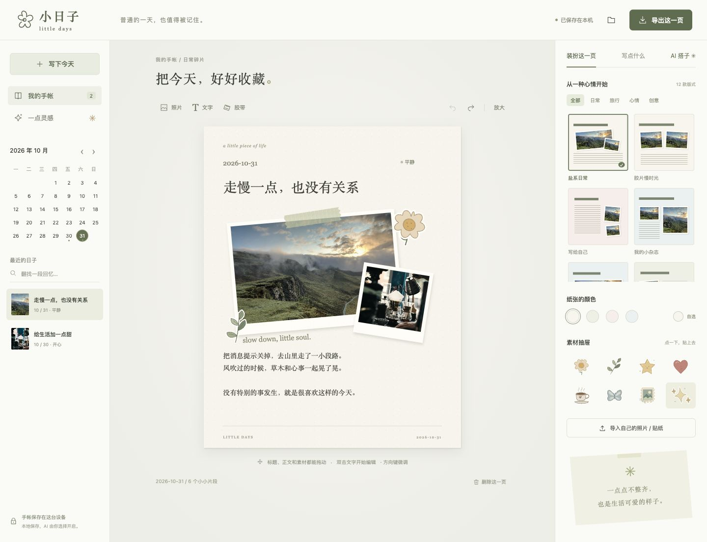

# 小日子 Little Days

**把普通的一天，收成喜欢的一页。**

A local-first scrapbook for the beautifully ordinary. Arrange your photos and writing freely, with an optional AI companion connected to your own compatible API.



一张照片，一段记录，几片贴纸。小日子是一个可以在本地编辑的每日手帐：不需要登录，打开就能开始写。**1.1 版**提供 12 款模板、自由文字排版，以及按需连接的 AI 搭子。

## 现在可以做什么

- **写下自己的日常。** 每页正文最多 1200 字符，记录日期与心情；同一天可以写多页。页面装不下时会提示调整排版或续写。
- **从 12 款模板开始。** 日常、旅行、心情、创意四类，包括盐系日常、胶片慢时光、写给自己、我的小杂志、远方明信片、植物观察簿、日常小票、双人拍立得、三格小画廊、深夜放映室、草莓软糖、留白一页。
- **把排版改成自己的。** 标题与正文可自由拖动，调整位置、宽高、字号和对齐，正文还可调整行高；四款预设纸色之外，也能自定义纸张颜色。
- **亲手拼贴。** 放入照片、文字、胶带与 8 枚原创贴纸，拖动、缩放、旋转、复制或调整层次。
- **收进自己的素材。** 导入 PNG、JPEG、WebP；透明 PNG 默认无相框，也可以随时切换相框。图片在浏览器里处理，原文件不会被改写。
- **安心改来改去。** 自动保存、撤销与重做；支持键盘移动素材和常用快捷键。
- **找到过去的某一天。** 用日历筛选，或搜索标题与正文。
- **把作品带走。** 导出 1440 × 1800 PNG；JSON 备份保留文字、照片和图层，重新导入时合并记录。
- **和 AI 一起创作。** 自行配置兼容 API，让 AI 帮忙改写、排版、配色或准备素材方案。可应用的方案先显示预览，由你确认应用，之后可以撤销。
- **选用素材创作 Skill。** 仓库附带三套原创 Agent Skills，帮你想主题、安排照片或准备贴纸；普通编辑不依赖 AI。

## 在本地打开

需要 Node.js 18 或更新版本。没有构建步骤，也没有需要安装的 npm 依赖。

```sh
git clone https://github.com/xinyunluuu/little-days.git
cd little-days
npm run dev
```

在浏览器打开终端显示的 [本地地址](http://127.0.0.1:4173)。保持这个终端运行；下次在项目目录执行 `npm run dev` 即可继续。它同时启动页面和本机 AI 代理；`npm start` 是同一启动命令的别名。

也可以用静态 HTTP 服务器或静态站点托管本目录，编辑、保存与导出仍可使用。**纯静态部署不包含 Node 代理，不能使用内置 AI 连接**；需要 AI 时运行上面的本机服务。请通过 HTTP 打开，不要直接双击 `index.html`。

## 写下第一篇

1. 点「写下今天」，给这一天取个名字，留下一段记录。
2. 选一种版式，导入照片；点击文字或素材，自由调整位置、大小、字号、旋转与相框。
3. 导出一张 PNG 留作纪念，再到备份面板下载完整 JSON。

首屏带有两篇虚构示例，方便体验；示例照片来自 Unsplash，不是用户的私人照片。可以修改或删除示例，开始自己的记录。

## 你的日记放在哪里

文字、图片和图层保存在**当前浏览器、当前网站地址的 IndexedDB** 中。应用没有账号或云端日记数据库，普通编辑不发送日记与照片。

本地存储与浏览器及网站来源绑定：换浏览器、换端口、从 `127.0.0.1` 改成 `localhost`，都会看到另一份资料库；它们不会自动同步。清理站点数据或结束隐私浏览也可能删除记录。定期下载 JSON 备份，迁移时在新地址导入。

PNG 是适合分享的成品图片；**JSON 才是能继续编辑的完整备份**。导入会保留现有日记：完全相同的记录跳过，同 ID 但内容不同的记录作为新的一页保留。细节见 [本地数据与备份](docs/storage.md)。

## 连接可选的 AI 搭子

用 `npm run dev` 启动后，在「AI 搭子」的「API 设置」中选择 OpenAI、DeepSeek、Ollama 本机服务或自定义兼容接口，填写 Base URL、可用模型名称和自己的 Key。保存配置不会发送模型请求；点击「发送给 AI」才会请求所选服务，并可能产生该服务商的费用。

默认只发送你输入的对话；勾选「附上本页文字与布局」后，才附上当前页文字与图层位置等信息。**照片像素和图片来源不发送**，因此 AI 不能看图，也不会替你重绘照片。素材模式提供方案和提示词，当前应用不内置图像生成。

**Key 仅保留在当前页面内存**，刷新后需要重新填写；它不会写入浏览器存储、日记备份、服务端配置或日志。请求时 Key 和选中的文字内容会经过本机代理发送给你指定的服务商。AI 提案先校验并预览，点击「应用到这一页」后才改动手帐，可用撤销恢复。接口支持范围、隐私边界和错误处理见 [AI API 说明](docs/ai-api.md)。

## 几个顺手的快捷键

| 操作 | 快捷键 |
| --- | --- |
| 保存 | `Ctrl / ⌘ + S` |
| 撤销 | `Ctrl / ⌘ + Z` |
| 重做 | `Ctrl / ⌘ + Shift + Z`，或 `Ctrl / ⌘ + Y` |
| 移动已聚焦素材 | 方向键；按住 `Shift` 每次移动 10 像素 |
| 删除已聚焦素材 | `Delete` 或 `Backspace` |
| 取消选择 | `Esc` |

编辑文字时，撤销与重做保留输入框的正常行为。画布编辑历史属于当前打开的页面会话，刷新后不会恢复。

## 可选的创作工具包

| Skill | 用途 |
| --- | --- |
| [little-days-theme](skills/little-days-theme/SKILL.md) | 从心情和配色整理一套主题与布局建议 |
| [little-days-photo-story](skills/little-days-photo-story/SKILL.md) | 用选定照片规划拼贴，保留照片与人物身份 |
| [little-days-sticker-sheet](skills/little-days-sticker-sheet/SKILL.md) | 设计原创素材；明确要求时使用可用图像工具制作透明 PNG |

这些 Skill 是独立说明文件，不会随网页自动运行，也不会自动把私人照片发给外部服务。图片生成取决于所选 Agent 的工具与授权；只要构图建议时，不调用生图。安装方式、隐私边界与示例见 [素材创作工具包](docs/creator-kit.md)。

## 设计与贡献

项目从电子手帐、纸艺、小刊和植物观察中寻找灵感，把素材感留在纸上，把操作保持清楚。我们整理了用户提供的素材 Skill 和热门设计工具，并逐项记录出处、许可证与热度快照：[设计方向](docs/design-direction.md) · [设计调研](docs/design-research.md) · [来源数据](docs/research-sources.json)。这些参考用于设计判断，不构成对传播效果或“出圈”的承诺。

欢迎贡献新的原创贴纸、版式、交互改进或缺陷修复。开发约定见 [CONTRIBUTING.md](CONTRIBUTING.md)；本地检查使用：

```sh
npm run check
npm test
```

这些命令不调用真实模型或付费 API；AI 链路测试使用 mock，不消耗模型 token。它们验证本地行为与接口边界，不证明远程模型的生成质量、延迟或可用性。浏览器里的保存、刷新、导入导出与移动端交互还需要实际验收。

## 许可

原创代码、图标、贴纸与三套项目 Skill 按 [MIT License](LICENSE) 发布。两张 Unsplash 示例照片遵循其各自适用的 [Unsplash License](https://unsplash.com/license)，不属于本项目 MIT 授权。详细来源见 [THIRD_PARTY.md](THIRD_PARTY.md)。
